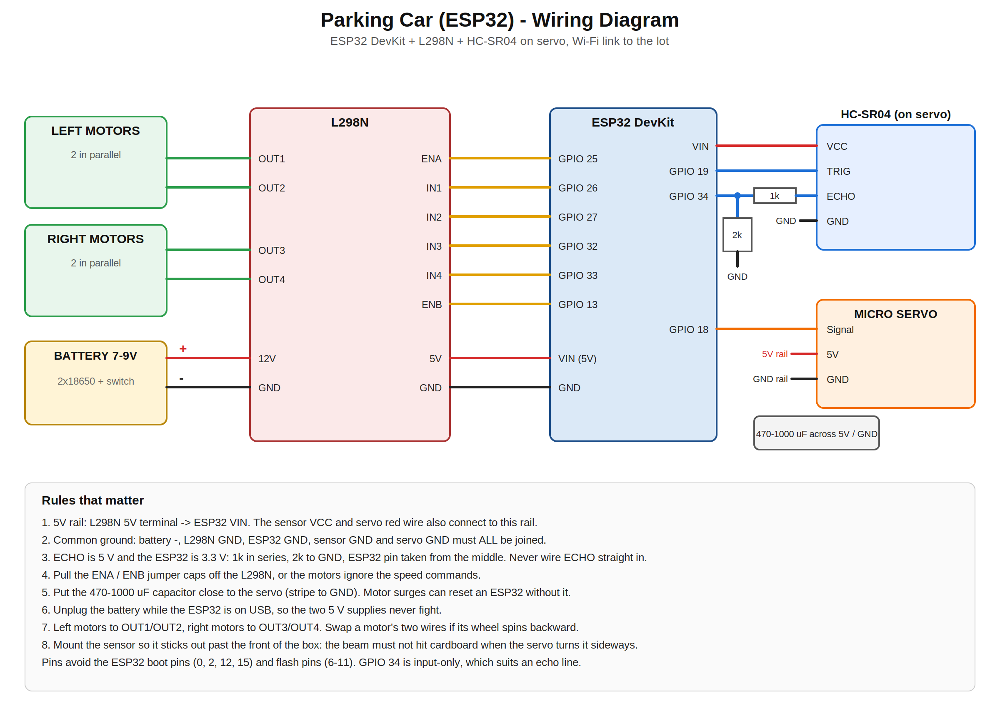

# Self-Parking Car: ESP32 + Wi-Fi Smart Parking Lot

A small autonomous car that drives to a parking-lot gate, receives a slot number over Wi-Fi from the lot's controller, drives to that slot without line following, checks the slot is free, and parks. It grew out of an obstacle-avoiding car (Arduino Uno, simulated in Tinkercad) and was rebuilt around an ESP32 so the car and the lot can talk to each other directly.




## What it does

1. The car powers on, joins the lot's Wi-Fi network and drives up to the gate line.
2. The lot's entry sensor detects the car and the lot picks the nearest free slot.
3. The lot sends `GO:n` to the car (the car polls for commands over HTTP).
4. The car drives straight down the corridor and stops when its front ultrasonic sensor reads the stored distance for slot *n* (a pre-mapped route measured from the end wall).
5. A servo swings the sensor sideways and the car confirms the slot opening is really there.
6. The car turns into the slot, creeps in until the back wall is a set distance away, and reports `parked`.
7. A ceiling sensor over the slot independently confirms the car is there, and the lot dashboard updates.

## Why distance-based routes instead of timed ones

A timed route ("drive 2 s, turn, drive 1 s") drifts with battery level, floor friction and motor mismatch. Using the front sensor's distance to a fixed wall as the car's position removes most of that. The stored values are measured once per layout (see calibration).

## System architecture

```
 CAR (ESP32)                                   LOT (ESP32)
 ┌──────────────────────────┐   Wi-Fi / HTTP   ┌──────────────────────────────┐
 │ HC-SR04 on SG90 servo    │  GET /car/cmd     │ Hosts the Wi-Fi network      │
 │ L298N + 4 TT motors      │ ───────────────►  │ 4 x HC-SR04 (entry + 3 slots)│
 │ State machine (see below)│  GET /car/event   │ 3 status LEDs                │
 └──────────────────────────┘ ◄───────────────  │ Web dashboard                │
                                                 └──────────────────────────────┘
```

| Request | Meaning |
|---|---|
| `GET /car/cmd` | reply `NONE`, `GO:n` or `STOP` |
| `GET /car/event?e=arrived` | car is at the gate |
| `GET /car/event?e=ack&slot=n` | car heard `GO:n` |
| `GET /car/event?e=parked&slot=n` | car stopped inside slot n |
| `GET /car/event?e=failed&slot=n` | car gave up |

## Car state machine

`CONNECTING → APPROACH_GATE → AT_GATE → GOTO_SLOT → VERIFY → TURNING → ENTERING → PARKED` (with `FAILED` and `IDLE`).

Safety checks: median-of-three sensor readings, two consecutive readings before acting, a stop if the echo goes missing, a stop if the car is already past its slot, and a route timeout.

## Hardware

See [`BOM.md`](BOM.md) and the wiring diagrams.

- Car: ESP32 DevKit, L298N, 4 TT gear motors (two per side in parallel, skid steering), SG90 servo, HC-SR04, 2 × 18650 cells for the motors, separate power bank for the ESP32.
- The HC-SR04 Echo pin is 5 V and the ESP32 is 3.3 V, so Echo goes through a 1 kΩ + 2 kΩ divider.
- Pins avoid the ESP32 boot-strap pins (0, 2, 12, 15) and flash pins (6 to 11).

## Firmware

| Folder | What it is |
|---|---|
| `parking_car_final` | Car program: gate, slot targeting, verify, park |
| `parking_controller` | Lot controller: sensors, Wi-Fi access point, dashboard, auto-dispatch |
| `step1_motor_test` | Checks wiring: each side, both, spins |
| `car_ramp_run` | Soft-start run: forward, turn left/right, 180, forward |
| `servo_sweep_test` | Sweeps the servo on its own |
| `servo_sensor_test` | Obstacle avoidance using the servo scan |
| `prototype-arduino-obstacle-car` | The earlier Arduino Uno obstacle-avoiding car (first prototype) |

**Libraries:** ESP32Servo (Library Manager). Wi-Fi, HTTPClient and WebServer come with the ESP32 core. Board: *ESP32 Dev Module*.

## Calibration

The distances in the car sketch are placeholders until measured on your own layout. Set `CALIBRATE_ONLY = true` in the car sketch, which makes the car print its front and side readings instead of driving, then record:

- `GATE_FRONT_CM`: front reading with the car on the gate line
- `SLOT_FRONT_CM[]`: front reading with the car centred on each slot
- `TURN_90_MS`: time for a clean 90° turn on your floor
- `LEFT_TRIM` / `RIGHT_TRIM`: speed added to a side to make the car go straight (if it veers left, raise `LEFT_TRIM`)

More in [`SYSTEM_NOTES.md`](SYSTEM_NOTES.md).

## Status


- [x] Obstacle-avoiding car simulated in Tinkercad (Arduino Uno + L293D stand-in, servo-scanned HC-SR04)
- [x] 4WD cardboard chassis built, motors verified forward, backward and spin
- [x] ESP32 uploads working, servo sweeps on its own
- [x] Soft-start motion sequence runs (straight-line drift being trimmed)
- [X] HC-SR04 readings verified with the echo divider on the car
- [X] Car and lot talking over Wi-Fi on real hardware
- [X] Parking lot model built and sensors calibrated
- [X] Full autonomous gate-to-slot run

The firmware was syntax-checked against both ESP32 Arduino core 2.x and 3.x APIs with a mock build. It has **not** been verified end to end on hardware yet.

## Results


## Known limitations

- The car only listens for commands while stationary (a Wi-Fi request can block for most of a second), so `STOP` mid-route is not heard.
- If the car fails mid-route it stops where it is and does not return to the gate.
- There is no exit flow yet. Only a release from parking lot is present where the car reverses straight.
- The 90° turn is timed, so it drifts as the battery drains.
- Stored distances only hold for one layout; moving a wall means recalibrating.
- Ultrasonic sensing struggles with soft or angled surfaces and Ultrasonic does not help much with parking except avoiding walls.

## Future work

- MPU6050 gyro for turns by measured angle and heading-hold on straight runs
- Wheel encoders for distance
- Exit flow, and returning to the gate after a failure
- Non-blocking command handling during motion
- RFID or wall markers to reset position error

## Repository layout

```
   car, lot, test sketches, first Arduino prototype
   BOM and wiring diagrams
   system notes (protocol, geometry, calibration)
```

## Credits

- Lot controller and dashboard: AgamPreet Singh, Vivek Bansal
- Car firmware and hardware build: M M Saathvik
- AI assistance: parts of the firmware and documentation were developed with help from an AI assistant (Claude). All code was reviewed, built and tested by the author. [Edit this line so it is accurate for you.]

## License

MIT. See [`LICENSE`](LICENSE).
